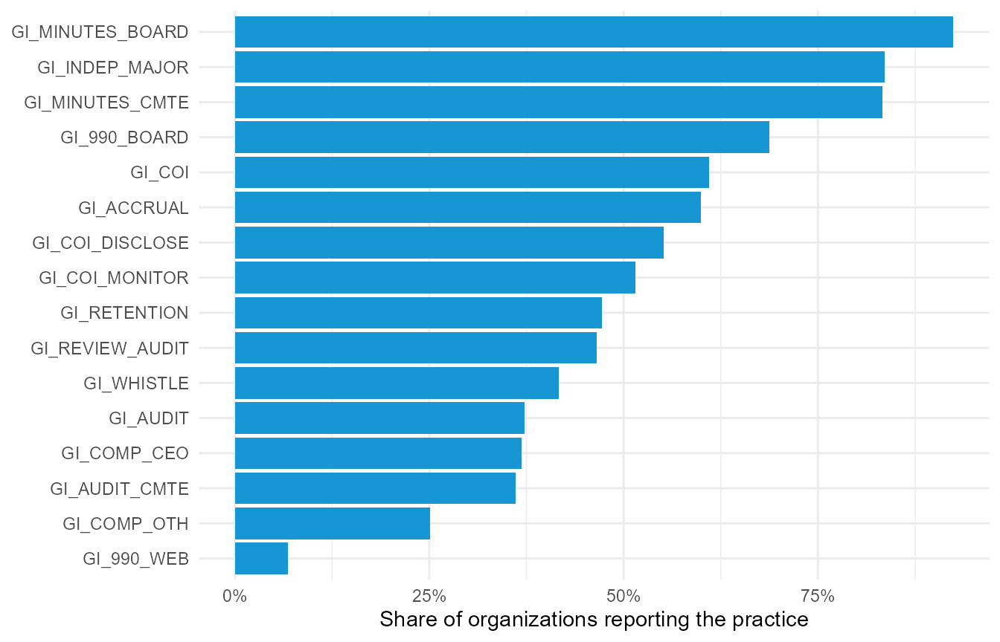
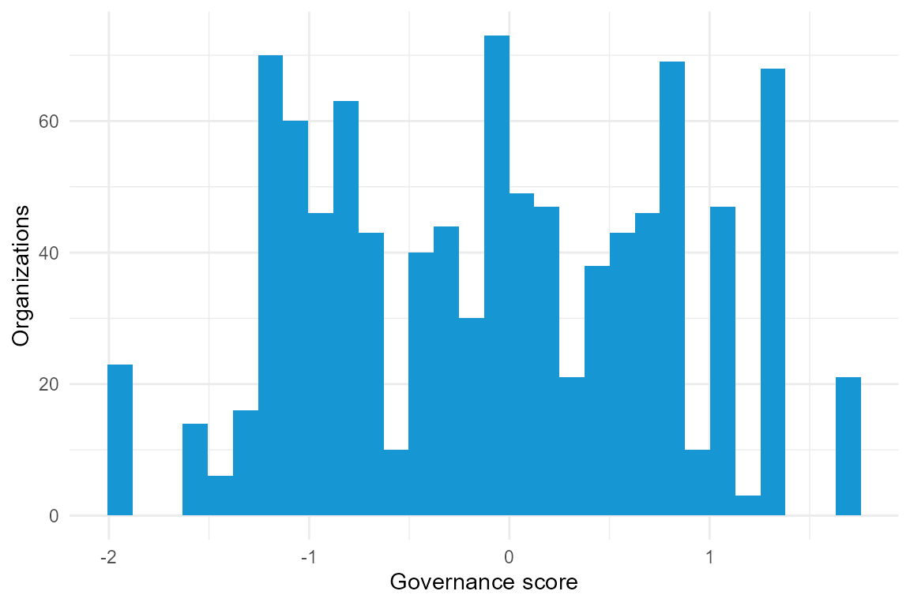
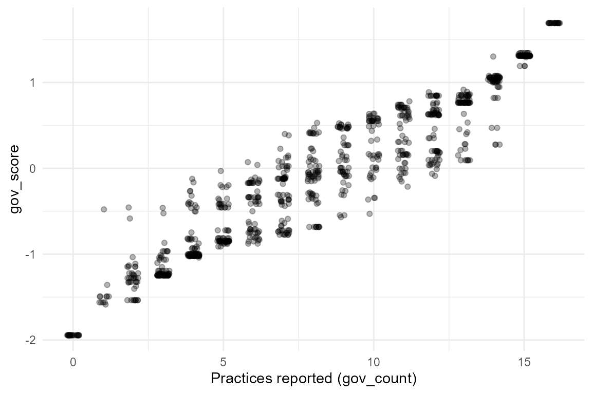

# Governance Workflow

``` r

library( governance )
library( dplyr )
library( ggplot2 )

theme_set( theme_minimal() )
```

This article walks through the path from raw 990 fields to governance
scores and explains each column the package adds. It uses the bundled
`dat_example`, a 5,000-organization sample of raw 2022 fields. In
practice the data come from
[`get_governance_data()`](https://nonprofit-open-data-collective.github.io/governance/reference/get_governance_data.md);
see
[`vignette("download-data")`](https://nonprofit-open-data-collective.github.io/governance/articles/download-data.md).

``` r

data( "dat_example", package = "governance" )

set.seed( 57 )
rows        <- sample( nrow(dat_example), 1000 )
dat_example <- dat_example[ rows, ]
```

## Step 1: Code the practice items

[`get_features()`](https://nonprofit-open-data-collective.github.io/governance/reference/get_features.md)
returns the input with three groups of columns appended.

| Columns | What they are | Used by |
|----|----|----|
| 16 `GI_*` items | Recommended practices, 1 = present | the 2023 index (default) |
| 5 `RISK_*` indicators | Reported risk events or exposures, 1 = reported | not scored; reported alongside |
| 12 `P*_LINE_*` features | Features of the 2018 model | `get_scores( model = "legacy-2018" )` |

``` r

features <- get_features( dat_example )
```

### Practice items

Each `GI_*` item records one practice. A blank answer is `NA`, not 0,
and the scoring model uses whichever items an organization answered.

| Item | Form 990 line | Practice |
|----|----|----|
| `GI_REVIEW_AUDIT` | XII-2a/2b, IV-12a/b | Financial statements compiled, reviewed or audited |
| `GI_AUDIT` | XII-2b, IV-12a/b | Financial statements audited by an independent accountant |
| `GI_AUDIT_CMTE` | XII-2c | A committee oversees the audit or review (0 if no review or audit) |
| `GI_ACCRUAL` | XII-1 | Accrual accounting |
| `GI_INDEP_MAJOR` | VI-1a/1b | At least half of voting members are independent |
| `GI_MINUTES_BOARD` | VI-8a | Board meetings documented |
| `GI_MINUTES_CMTE` | VI-8b | Committee meetings documented |
| `GI_990_BOARD` | VI-11a | Form 990 given to the board before filing |
| `GI_COI` | VI-12a | Written conflict-of-interest policy |
| `GI_COI_DISCLOSE` | VI-12b | Annual disclosure of interests (0 without a policy) |
| `GI_COI_MONITOR` | VI-12c | Policy monitored and enforced (0 without a policy) |
| `GI_WHISTLE` | VI-13 | Written whistleblower policy |
| `GI_RETENTION` | VI-14 | Written document retention and destruction policy |
| `GI_COMP_CEO` | VI-15a | Independent pay-setting process for the top executive |
| `GI_COMP_OTH` | VI-15b | Independent pay-setting process for other officers |
| `GI_990_WEB` | VI-18 | Form 990 posted on the organization’s own website |

Practices differ a great deal in how common they are. Nearly every filer
documents board meetings; fewer than one in ten posts its 990 online.

``` r

rates <-
  features |>
  summarise( across(starts_with("GI_"), \(x) mean(x, na.rm = TRUE)) ) |>
  tidyr::pivot_longer( everything(), names_to = "item", values_to = "share" )

ggplot( rates, aes(x = share, y = reorder(item, share)) ) +
  geom_col( fill = "#1696d2" ) +
  scale_x_continuous( labels = scales::percent ) +
  labs( x = "Share of organizations reporting the practice", y = NULL )
```



### Risk indicators

The `RISK_*` columns record events that good governance is meant to
manage: business transactions with insiders (IV-28a/b/c), loans to
insiders (IV-26), family or business ties among officers (VI-2), use of
a management company (VI-3) and asset diversions (VI-5). They are not
part of the index. They are disclosures, not practices, and they rise
with organization size, so they correlate *positively* with good
practice. Report them alongside the score.

``` r

features |>
  summarise( across(starts_with("RISK_"), \(x) mean(x, na.rm = TRUE)) ) |>
  tidyr::pivot_longer( everything(), names_to = "indicator", values_to = "share" ) |>
  knitr::kable( digits = 3 )
```

| indicator        | share |
|:-----------------|------:|
| RISK_INSIDER_BIZ | 0.053 |
| RISK_LOAN        | 0.024 |
| RISK_FAM_TIES    | 0.136 |
| RISK_MGMT_CO     | 0.058 |
| RISK_DIVERSION   | 0.001 |

## Step 2: Calculate the scores

``` r

scores <- get_scores( features )
```

[`get_scores()`](https://nonprofit-open-data-collective.github.io/governance/reference/get_scores.md)
appends eight columns.

| Column | Meaning |
|----|----|
| `gov_score` | General governance score. 0 is the average 2023 filer; one unit is one SD of the latent factor among 2023 filers. |
| `gov_score_se` | Standard error of `gov_score`. |
| `gov_s_finance` | Financial-assurance specific factor (audit, review, audit committee, accrual). |
| `gov_s_minutes` | Minutes specific factor (board and committee minutes). |
| `gov_s_policy` | Written-policies specific factor (conflict of interest, whistleblower, retention). |
| `gov_s_comp` | Compensation specific factor (CEO and other-officer pay process). |
| `gov_count` | Number of the 16 practices reported (0–16). |
| `gov_n_items` | Number of the 16 items answered. |

The specific factors are *residuals*. They are uncorrelated with
`gov_score`, and a positive value means the organization does more in
that area than its general score predicts. They are not standalone
subscales: an organization with a high `gov_s_finance` and a low
`gov_score` is one that is audited but has few other practices.

``` r

ggplot( scores, aes(x = gov_score) ) +
  geom_histogram( bins = 30, fill = "#1696d2" ) +
  labs( x = "Governance score", y = "Organizations" )
```



### Score or count?

`gov_count` is a transparent alternative: the number of practices
reported. It correlates about .96 with `gov_score`. The model-based
score adds three things: practices are weighted by how much they reveal
about governance, every score has a standard error, and the scale is
anchored to 2023 so it does not drift as practices spread.

``` r

ggplot( scores, aes(x = gov_count, y = gov_score) ) +
  geom_jitter( width = 0.2, alpha = 0.3 ) +
  labs( x = "Practices reported (gov_count)", y = "gov_score" )
```



The vertical spread at each count shows the weighting at work. Two
organizations that report eight practices can differ by a full unit,
depending on *which* eight.

### Precision

Scores are least precise at the ends of the scale, where few items
discriminate. Treat differences smaller than about two standard errors
as noise, especially at the top and bottom.

``` r

scores |>
  mutate( quintile = ntile(gov_score, 5) ) |>
  group_by( quintile ) |>
  summarise( mean_score = mean(gov_score), mean_se = mean(gov_score_se) ) |>
  knitr::kable( digits = 2 )
```

| quintile | mean_score | mean_se |
|---------:|-----------:|--------:|
|        1 |      -1.27 |    0.51 |
|        2 |      -0.72 |    0.30 |
|        3 |      -0.08 |    0.19 |
|        4 |       0.50 |    0.30 |
|        5 |       1.14 |    0.53 |

### Missing answers

Rows with blank answers are still scored from the items they did answer;
their standard errors are larger. Rows that answered none of the 16
items get `NA` scores.

``` r

table( items_answered = scores$gov_n_items ) |>
  knitr::kable( col.names = c("Items answered", "Organizations") )
```

| Items answered | Organizations |
|:---------------|--------------:|
| 14             |             1 |
| 15             |            22 |
| 16             |           977 |

## Comparing organizations

Size is the strongest predictor of almost every practice, partly because
audits are required above state and federal thresholds. Compare
organizations of similar size, or adjust for size in a model.
[`vignette("overview")`](https://nonprofit-open-data-collective.github.io/governance/articles/overview.md)
shows the size gradient across the whole sector.

To relate scores to size, sector or location, join them to the NCCS
[Business Master
File](https://nccs.urban.org/nccs/catalogs/catalog-bmf.html) on
`ORG_EIN`. The snippet below is not run here because it downloads a
large file.

``` r

bmf_url <- paste0( "https://nccsdata.s3.us-east-1.amazonaws.com/",
                   "bmf/unified/v1.2/UNIFIED_BMF_V1.2.csv" )

bmf     <- readr::read_csv( bmf_url )
bmf$EIN <- stringr::str_pad( gsub("\\D", "", bmf$EIN), 9, pad = "0" )

joined <- left_join( scores, bmf, by = c("ORG_EIN" = "EIN") )
```

## The legacy 2018 model

Earlier versions of the package scored organizations with a six-factor
model fit to 2018 data. It is kept for reproducing earlier work, but it
has known problems, including negative weights on several good
practices. See
[`vignette("legacy-2018-model")`](https://nonprofit-open-data-collective.github.io/governance/articles/legacy-2018-model.md).

``` r

legacy <- get_scores( features, model = "legacy-2018" )
```
