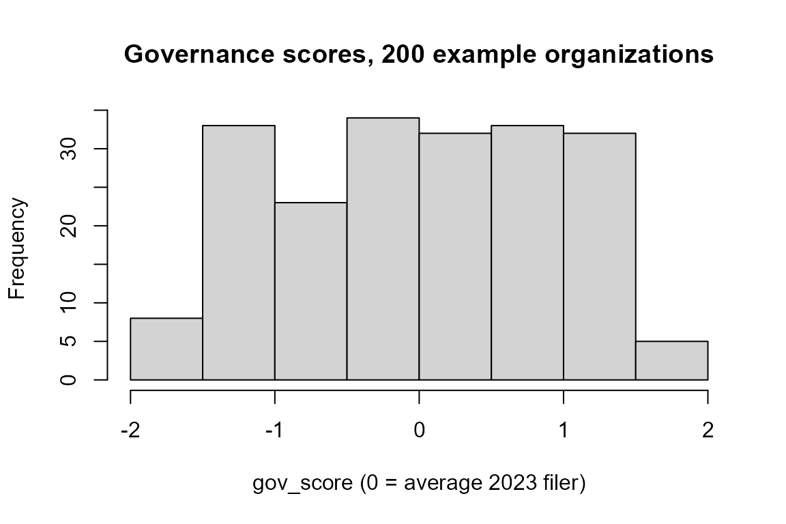

# Getting Started

``` r

library( governance )
library( dplyr )
```

The **governance** package scores nonprofit governance from the IRS Form
990. Since the 2008 redesign, Part VI of the 990 asks every full filer
about its board, its written policies and its disclosure practices, and
Parts IV and XII record audits and financial oversight. The package
turns those answers into 16 indicators of recommended practice and
combines them into a single governance index, `gov_score`.

The index comes from an item response model fit to every 501(c)(3)
organization that e-filed a full Form 990 for tax year 2023 (about
271,000 organizations). Its parameters are fixed, so a score from any
year is on the same scale: 0 is the average 2023 filer, and one unit is
one standard deviation of governance among 2023 filers.

The workflow has two steps:

1.  [`get_features()`](https://nonprofit-open-data-collective.github.io/governance/reference/get_features.md)
    codes the raw 990 fields as binary practice items.
2.  [`get_scores()`](https://nonprofit-open-data-collective.github.io/governance/reference/get_scores.md)
    scores the items with the 2023 model.

## Step 1: Get input data

[`get_features()`](https://nonprofit-open-data-collective.github.io/governance/reference/get_features.md)
expects one row per filing with the raw efile fields from Form 990 Parts
IV, VI and XII and Schedule M. The companion
[panel990](https://github.com/Nonprofit-Open-Data-Collective/panel990)
package retrieves them; `get_governance_data( years = 2023 )` returns a
data frame ready for the next step. See
[`vignette("download-data")`](https://nonprofit-open-data-collective.github.io/governance/articles/download-data.md)
for the tables and fields.

The package also ships `dat_example`, a 5,000-organization sample of raw
2022 fields, so you can try the workflow without downloading anything.

``` r

data( "dat_example", package = "governance" )

# a 200-organization subset keeps the examples fast
set.seed( 57 )
rows        <- sample( nrow(dat_example), 200 )
dat_example <- dat_example[ rows, ]
```

## Step 2: Code the practice items

[`get_features()`](https://nonprofit-open-data-collective.github.io/governance/reference/get_features.md)
adds 16 `GI_*` columns, one per practice, coded 1 when the organization
reports the practice, 0 when it does not and `NA` when the question was
left blank. It also adds five `RISK_*` disclosure indicators and the 12
features used by the older 2018 model.

``` r

features <- get_features( dat_example )

# share of organizations reporting each practice
features |>
  summarise( across(starts_with("GI_"), \(x) mean(x, na.rm = TRUE)) ) |>
  tidyr::pivot_longer( everything(), names_to = "item", values_to = "share" ) |>
  knitr::kable( digits = 2 )
```

| item             | share |
|:-----------------|------:|
| GI_REVIEW_AUDIT  |  0.50 |
| GI_AUDIT         |  0.39 |
| GI_AUDIT_CMTE    |  0.38 |
| GI_ACCRUAL       |  0.64 |
| GI_INDEP_MAJOR   |  0.83 |
| GI_MINUTES_BOARD |  0.92 |
| GI_MINUTES_CMTE  |  0.81 |
| GI_990_BOARD     |  0.69 |
| GI_COI           |  0.64 |
| GI_COI_DISCLOSE  |  0.58 |
| GI_COI_MONITOR   |  0.54 |
| GI_WHISTLE       |  0.48 |
| GI_RETENTION     |  0.52 |
| GI_COMP_CEO      |  0.40 |
| GI_COMP_OTH      |  0.28 |
| GI_990_WEB       |  0.10 |

## Step 3: Calculate the scores

[`get_scores()`](https://nonprofit-open-data-collective.github.io/governance/reference/get_scores.md)
appends the governance score and its standard error, four
specific-factor scores and `gov_count`, the number of the 16 practices
the organization reports.

``` r

scores <- get_scores( features )

vars <- c( "ORG_NAME_L1", "gov_score", "gov_score_se", "gov_count" )

scores[ , vars ] |>
  head() |>
  knitr::kable( digits = 2 )
```

|  | ORG_NAME_L1 | gov_score | gov_score_se | gov_count |
|:---|:---|---:|---:|---:|
| 849 | BLUE RIDGE WOMENS CENTER INC | 0.85 | 0.44 | 12 |
| 2532 | SPECTRUM THEATRE ENSEMBLE | -0.72 | 0.30 | 7 |
| 2699 | WESTERN INSTITUTE FOR VETERANS RESEARCH | 1.03 | 0.51 | 14 |
| 2478 | Spida Inc | 0.13 | 0.20 | 10 |
| 531 | Oak School of Delray Beach Inc | -1.00 | 0.43 | 4 |
| 3673 | GROW WELLNESS FOUNDATION | -1.94 | 0.65 | 0 |

``` r

hist( scores$gov_score,
      main = "Governance scores, 200 example organizations",
      xlab = "gov_score (0 = average 2023 filer)" )
```



## Where to go next

- [`vignette("overview")`](https://nonprofit-open-data-collective.github.io/governance/articles/overview.md):
  how governance practices vary by size, subsector, state and year
  across all 501(c)(3) filers.
- [`vignette("governance-workflow")`](https://nonprofit-open-data-collective.github.io/governance/articles/governance-workflow.md):
  a fuller walk-through of the outputs.
- [`vignette("making-gov-scores")`](https://nonprofit-open-data-collective.github.io/governance/articles/making-gov-scores.md):
  how the items were chosen and the model fit.
- [`vignette("download-data")`](https://nonprofit-open-data-collective.github.io/governance/articles/download-data.md):
  retrieving 990 data with panel990.
