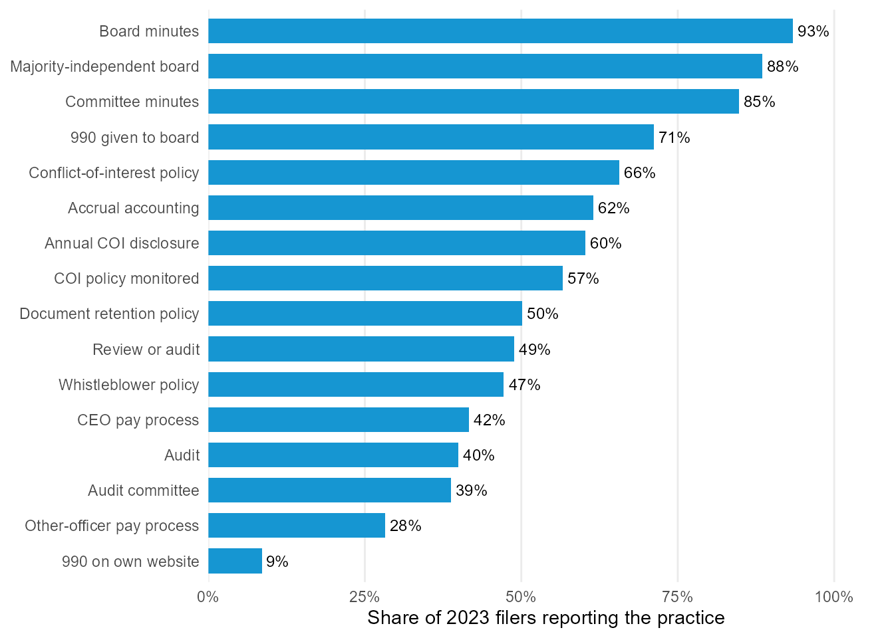
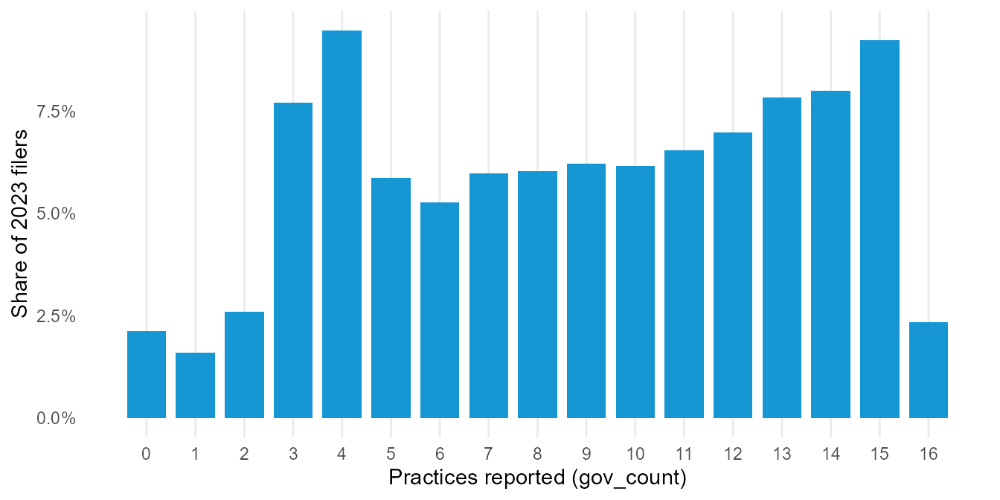
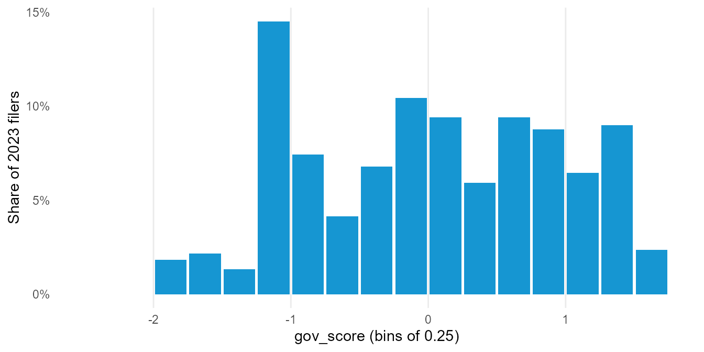
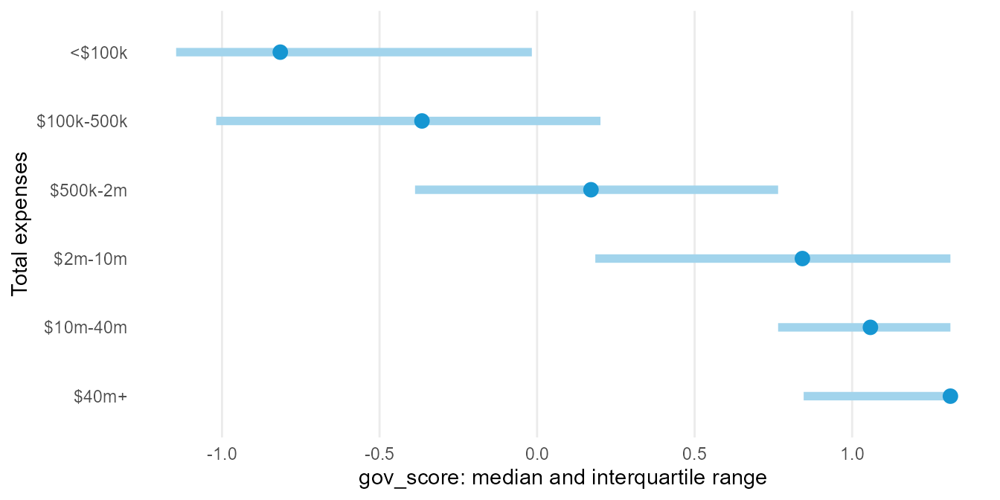
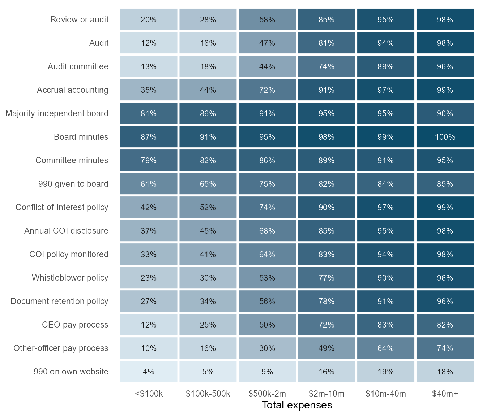
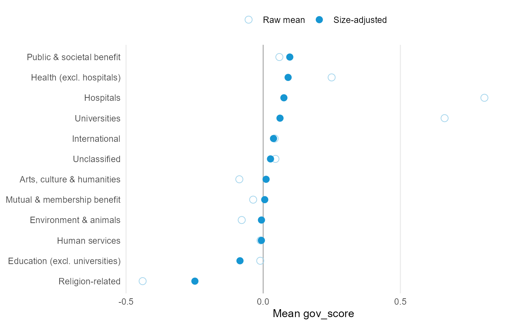
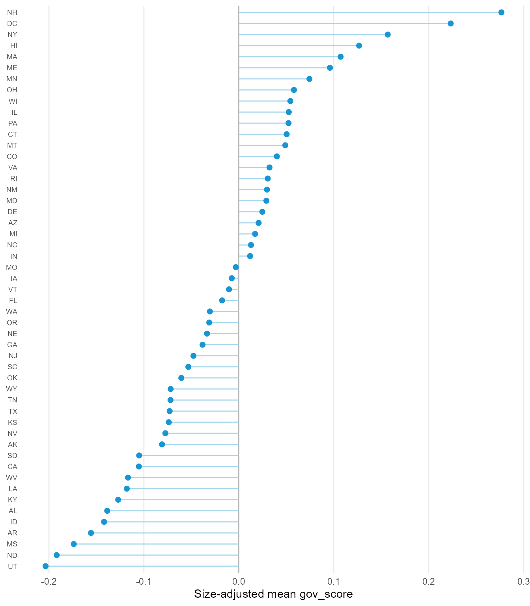
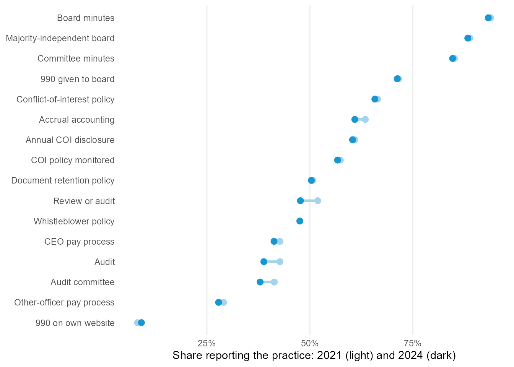

# Governance Across the Sector

This article describes how governance practices vary across the U.S.
nonprofit sector. It covers every 501(c)(3) organization that e-filed a
full Form 990 for tax years 2021 to 2024: **271,116 organizations in
2023**. Each was scored with
[`get_features()`](https://nonprofit-open-data-collective.github.io/governance/reference/get_features.md)
and
[`get_scores()`](https://nonprofit-open-data-collective.github.io/governance/reference/get_scores.md),
so the results are on the index scale described in
[`vignette("making-gov-scores")`](https://nonprofit-open-data-collective.github.io/governance/articles/making-gov-scores.md).
The scale is set so that 2023 filers have mean 0 and standard deviation
1 on the underlying (latent) governance factor; the estimated scores
average 0.02 with a standard deviation of 0.91, slightly less than 1
because each estimate is pulled toward the mean in proportion to its
uncertainty.

The figures come from summary tables built by
[`data-raw/make-overview-data.R`](https://github.com/Nonprofit-Open-Data-Collective/governance/blob/main/data-raw/make-overview-data.R)
and saved with the vignette; nothing is downloaded when the article is
built. Subsector and state come from the NCCS Business Master File; size
is total expenses (Form 990 Part I line 18).

## How common is each practice?

Practices range from nearly universal to rare. More than nine in ten
filers document board meetings, and most have a majority-independent
board. About two-thirds have a conflict-of-interest policy, about half
have whistleblower and retention policies or an independent review or
audit, and fewer than one in ten post their 990 on their own website.



The number of practices reported is bimodal. One group of organizations
reports three or four practices, mostly the near-universal ones such as
board minutes and an independent board; a larger group reports 13 to 15.
Fewer than 3% report all 16, because posting the 990 online is rare even
among organizations that do everything else.





The score distribution is lumpy, not bell-shaped, because the index is
built from 16 yes/no items: many organizations share the same response
pattern and so the same score. The tallest spike, just above −1.25, is
organizations that report only the near-universal practices, such as
minutes and an independent board. The cluster around 1.3 is
organizations that report every practice except posting the 990 online.
Scores at the top and bottom are the least precise (mean standard error
about 0.6, against 0.2 in the middle).

## Size

Size is the strongest correlate of governance. The Spearman correlation
between `gov_score` and log expenses is **0.57** (0.62 for the count).
The average score rises by 1.7 points from organizations spending under
\$100,000 to those spending \$40 million or more, and the typical
organization goes from about 6 practices to about 14.

| Size        | Organizations | Mean score | 25th pct | Median | 75th pct | Mean practices |
|:------------|--------------:|-----------:|---------:|-------:|---------:|---------------:|
| \<\$100k    |        38,532 |      -0.56 |    -1.15 |  -0.82 |    -0.02 |            5.7 |
| \$100k-500k |        99,104 |      -0.37 |    -1.02 |  -0.37 |     0.20 |            6.8 |
| \$500k-2m   |        69,951 |       0.15 |    -0.39 |   0.17 |     0.77 |            9.7 |
| \$2m-10m    |        40,582 |       0.68 |     0.18 |   0.84 |     1.31 |           12.4 |
| \$10m-40m   |        15,133 |       0.99 |     0.77 |   1.06 |     1.31 |           13.8 |
| \$40m+      |         7,814 |       1.11 |     0.85 |   1.31 |     1.31 |           14.2 |



In the three largest size bands the 75th percentile is the same, 1.31:
at least a quarter of those organizations report every practice except
posting the 990 online. The index has little room to separate
organizations at the top.

Practices rise with size, but not equally. Audits show the steepest
gradient, from 12% of the smallest organizations to 98% of the largest;
audits are often required above state revenue thresholds and the federal
single-audit threshold. Written whistleblower and retention policies and
the CEO pay process rise almost as steeply. Board minutes are common at
every size, and majority independence *falls* slightly in the largest
band, where the CEO often sits on the board. The chart reads across:
each row is a practice, each column a size band.



Because size drives adoption so strongly, the comparisons below are
shown two ways: the raw mean score, and a **size-adjusted** mean that
compares each organization with others in the same size band (the mean
of `gov_score` minus its size-band mean). A positive size-adjusted value
means the group does better than organizations of the same size
elsewhere.

## Subsector

| Subsector | Organizations | Mean score | Size-adjusted | Mean practices |
|:---|---:|---:|---:|---:|
| Public & societal benefit | 26,891 | 0.06 | 0.10 | 9.0 |
| Health (excl. hospitals) | 23,132 | 0.25 | 0.09 | 10.0 |
| Hospitals | 3,713 | 0.81 | 0.08 | 12.8 |
| Universities | 2,153 | 0.66 | 0.06 | 12.3 |
| International | 5,992 | 0.04 | 0.04 | 8.8 |
| Unclassified | 46,367 | 0.04 | 0.03 | 9.0 |
| Arts, culture & humanities | 21,450 | -0.09 | 0.01 | 8.3 |
| Mutual & membership benefit | 303 | -0.04 | 0.01 | 8.4 |
| Environment & animals | 13,068 | -0.08 | -0.01 | 8.2 |
| Human services | 81,188 | -0.01 | -0.01 | 8.7 |
| Education (excl. universities) | 33,399 | -0.01 | -0.08 | 8.7 |
| Religion-related | 13,460 | -0.44 | -0.25 | 6.3 |



Much of the raw difference between subsectors is size. Hospitals and
universities have the highest raw means (about 0.8 and 0.7) because they
are large; compared with organizations of the same size they are only
slightly above average. After adjusting for size, public and societal
benefit and health organizations score highest, and religion-related
organizations score lowest by a wide margin (a quarter of a point below
organizations of the same size). Read the “Unclassified” row with care:
about one in six filers has no usable NTEE code in the Business Master
File.

## Geography

Size-adjusted state means span about half a point, from New Hampshire
and the District of Columbia at the top to Utah and North Dakota at the
bottom: much less than the size gradient, and similar to the spread
across subsectors. The table lists the five highest and lowest states;
the chart shows every state.

| State | Organizations | Mean score | Size-adjusted |
|:------|--------------:|-----------:|--------------:|
| NH    |         1,565 |       0.27 |          0.28 |
| DC    |         3,785 |       0.50 |          0.22 |
| NY    |        21,120 |       0.23 |          0.16 |
| HI    |         1,459 |       0.14 |          0.13 |
| MA    |         8,167 |       0.18 |          0.11 |
| ID    |         1,281 |      -0.18 |         -0.14 |
| AR    |         2,092 |      -0.18 |         -0.16 |
| MS    |         1,599 |      -0.20 |         -0.17 |
| ND    |         1,028 |      -0.20 |         -0.19 |
| UT    |         1,786 |      -0.16 |         -0.20 |



State differences may reflect charity regulation: some states require
audits or reviews above revenue thresholds, and some require registered
charities to adopt particular policies. The index does not separate
those rules from other regional differences.

## Organization age

Older organizations report more practices, and the gradient remains,
smaller, after adjusting for size: organizations under five years old
score about a tenth of a point below others of their size, and those
over 40 years old about a tenth above. Age is years since the IRS ruling
date (or, where missing, the year of formation on the 990).

| Age       | Organizations | Mean score | Size-adjusted | Mean practices |
|:----------|--------------:|-----------:|--------------:|---------------:|
| \<5 years |        37,215 |      -0.30 |         -0.12 |            7.0 |
| 5-9       |        37,818 |      -0.21 |         -0.11 |            7.6 |
| 10-19     |        51,280 |      -0.08 |         -0.02 |            8.3 |
| 20-39     |        87,029 |       0.08 |          0.05 |            9.2 |
| 40+       |        57,682 |       0.35 |          0.10 |           10.6 |

## Specific factors

The four specific-factor scores show where groups depart from what their
general score predicts. They average zero by construction, so they are
most useful for comparing groups. Larger organizations do *more*
financial assurance and have more pay-setting processes than their
general score predicts, which echoes the size effect on audits discussed
in
[`vignette("making-gov-scores")`](https://nonprofit-open-data-collective.github.io/governance/articles/making-gov-scores.md).
Minutes and written policies show no size pattern beyond the general
score.

| Size        | Financial assurance | Minutes | Written policies | Compensation |
|:------------|--------------------:|--------:|-----------------:|-------------:|
| \<\$100k    |               -0.25 |   -0.03 |             0.01 |        -0.19 |
| \$100k-500k |               -0.22 |    0.01 |             0.01 |        -0.08 |
| \$500k-2m   |                0.09 |    0.01 |             0.00 |         0.04 |
| \$2m-10m    |                0.39 |   -0.01 |            -0.03 |         0.15 |
| \$10m-40m   |                0.47 |   -0.01 |            -0.04 |         0.25 |
| \$40m+      |                0.49 |    0.04 |            -0.05 |         0.29 |

## Risk disclosures

Risk events are reported separately from the index. Insider business
transactions rise steeply with size, from 1% of the smallest
organizations to 23% of the largest, and management companies rise from
3% to 7%. That is the opposite of what a “bad governance” reading would
predict: larger organizations have more transactions to disclose and
more processes for finding them. Loans to insiders and family or
business ties among officers are roughly flat across sizes.

| Disclosure | \<\$100k | \$100k-500k | \$500k-2m | \$2m-10m | \$10m-40m | \$40m+ |
|:---|:---|:---|:---|:---|:---|:---|
| Insider business transaction | 1% | 3% | 5% | 8% | 10% | 23% |
| Loan to or from insider | 2% | 2% | 3% | 3% | 2% | 4% |
| Family or business ties | 15% | 15% | 15% | 13% | 13% | 19% |
| Management company | 3% | 4% | 5% | 5% | 8% | 7% |
| Asset diversion | 0% | 0% | 0% | 0% | 0% | 0% |

Asset diversions are reported by about 1 in 1,000 filers, too few to
analyze here.

## Change over time, 2021–2024

Because the item parameters are fixed at 2023 values, scores from
different years are directly comparable. Across the whole population,
the mean score *fell* slightly from 2021 to 2024, and so did the mean
number of practices.

| Tax year | Organizations | Mean score |   SD | Mean practices |
|:---------|--------------:|-----------:|-----:|---------------:|
| 2021     |       251,937 |      0.039 | 0.90 |           9.00 |
| 2022     |       262,487 |      0.023 | 0.90 |           8.89 |
| 2023     |       271,116 |      0.015 | 0.91 |           8.82 |
| 2024     |       274,931 |      0.015 | 0.91 |           8.79 |



Most practices were flat. The exceptions are the financial-assurance
items: the share of filers reporting an audit, an audit committee, or a
review or audit each fell by three to four points, and accrual
accounting by about two. Population means mix two things, though: change
within organizations, and organizations entering or leaving the full-990
population. The table below follows the 221,759 organizations that filed
a full 990 in both 2021 and 2024.

Among them, 20% reported more practices in 2024 than in 2021, 66% the
same number and 14% fewer, and the mean score rose by 0.05. Continuing
organizations improved, so the falling population mean points to
composition: the organizations entering the full-990 population report
fewer practices than those leaving it. One possible reason: the
thresholds for filing the 990-EZ instead are fixed in dollars, so
inflation moves more small organizations onto the full 990 each year,
and small organizations are less often audited. Gains were largest in
the middle size bands; the largest organizations, already near the
ceiling, barely changed.

| Size (2023) | Organizations | Mean 2021 | Mean 2024 | Change | More practices | Same | Fewer |
|:------------|--------------:|----------:|----------:|-------:|---------------:|-----:|------:|
| \<\$100k    |        25,141 |     -0.53 |     -0.51 | +0.019 |            14% |  74% |   13% |
| \$100k-500k |        72,573 |     -0.33 |     -0.28 | +0.048 |            20% |  66% |   15% |
| \$500k-2m   |        63,260 |      0.14 |      0.20 | +0.064 |            24% |  60% |   16% |
| \$2m-10m    |        38,502 |      0.66 |      0.71 | +0.049 |            21% |  65% |   14% |
| \$10m-40m   |        14,649 |      0.98 |      1.01 | +0.023 |            15% |  73% |   12% |
| \$40m+      |         7,634 |      1.11 |      1.11 | +0.003 |            10% |  79% |   11% |

Year-to-year changes in a single organization’s count are common in both
directions, and many are one practice, so individual changes are noisy.
Changes in the average are more reliable than changes for any one
organization.

## Caveats

- **Reported, not observed.** The 990 records whether a policy exists,
  not whether it is followed.
- **Full 990 filers only.** Smaller organizations that file the 990-EZ
  or 990-N are not covered; their governance is likely weaker than the
  smallest band here.
- **Size and audits.** Audit, review and accrual items function
  differently by size (see
  [`vignette("making-gov-scores")`](https://nonprofit-open-data-collective.github.io/governance/articles/making-gov-scores.md)).
  Size-adjusted comparisons reduce, but do not remove, that effect.
- **Descriptive only.** None of the differences above are causal.

## Producing your own breakouts

The same tables can be built for any sample: score it, join size, sector
or place from the Business Master File, and summarise by group. For
example, with a scored data frame `scores` that has an `expenses`
column:

``` r

breaks <- c( -Inf, 1e5, 5e5, 2e6, 1e7, 4e7, Inf )
labels <- c( "<$100k", "$100k-500k", "$500k-2m", "$2m-10m", "$10m-40m", "$40m+" )

scores$size <- cut( scores$expenses, breaks, labels, right = FALSE )

scores |>
  group_by( size ) |>
  summarise( n = n(), mean_score = mean(gov_score, na.rm = TRUE),
             audited = mean(GI_AUDIT, na.rm = TRUE) )
```
